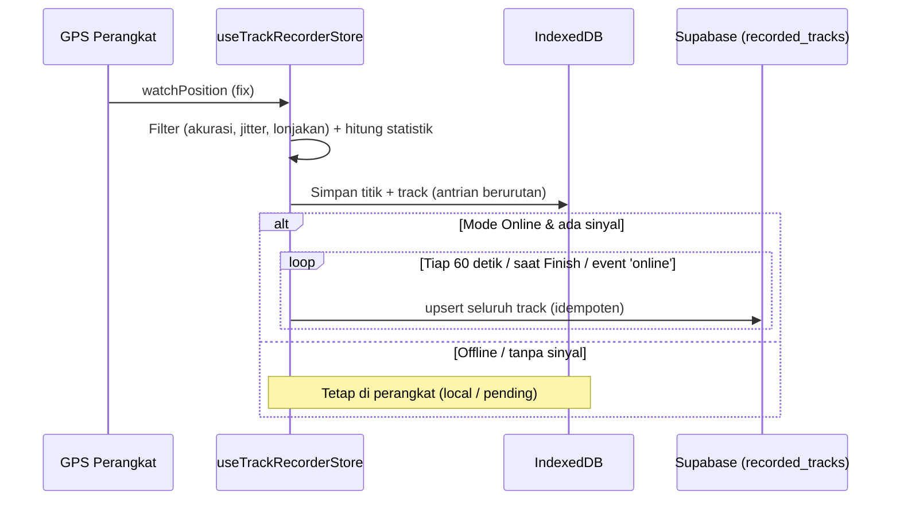

# Track Recorder (Online & Offline)

Track Recorder merekam **jejak GPS pribadi** (seperti Strava / Gaia GPS): rute, jarak, durasi, kecepatan, dan elevasi. Fitur ini **terpisah** dari Live Tracking / Monitoring (`Tracker.md`): tidak mengirim lokasi realtime ke monitor, dan tidak bergantung pada `VITE_ENABLE_GPS_TRACKER`.

## Hak Akses

| Akun | Merekam & membagikan | Ganti nama track cloud | Melihat track sendiri & yang dibagikan |
|---|---|---|---|
| Free | ❌ Tab Record terkunci ("Hubungi Admin") | ❌ (tombol Rename disembunyikan) | ✅ |
| Pro | ❌ Tab Record terkunci ("Hubungi Admin") | ✅ | ✅ |
| Enterprise (User maupun Monitor) | ✅ | ✅ | ✅ |
| Admin (`profiles.is_admin`) | ✅ | ✅ | ✅ |

Panel Track Recorder bisa dibuka semua akun yang login (untuk melihat track lama dan track yang dibagikan); **merekam dan membagikan** hanya Enterprise & admin. Track yang hanya ada di perangkat (belum pernah ke cloud) selalu bisa diganti namanya.

Dicek di dua lapis:
1. **UI**: `canRecordTracks()` dan `canRenameCloudTracks()` di `src/store/useTrackRecorderStore.ts`.
2. **Database**: fungsi `can_use_track_recorder()` + RLS di `recorded_tracks` dan `recorded_track_shares`. Ganti nama lewat RPC `rename_recorded_track()` (`20261024000004_storage_quotas.sql`) yang hanya mengubah kolom `name`, sehingga Pro bisa rename tanpa bisa mengubah titik GPS. Jadi walaupun UI diakali, server tetap menolak.

Track juga dihitung dalam **kuota penyimpanan cloud** akun (lihat README, "Cloud Storage Quotas"). Jika kuota penuh, sinkronisasi ke cloud ditolak, tetapi rekaman tetap aman di perangkat dan bisa di-upload lagi setelah ada ruang.

Jika plan turun (mis. Enterprise → Pro) saat sedang merekam, rekaman **di-pause, bukan dihapus**. Track lama tetap bisa dilihat & dihapus.

## Konsep: Local-first

Setiap titik GPS yang diterima **langsung disimpan di perangkat (IndexedDB)** sebelum hal lain. Karena itu rekaman aman walau sinyal hilang, browser di-refresh, aplikasi ditutup, atau HP mati.

| Mode | Penyimpanan | Sinkron ke cloud |
|---|---|---|
| **Online** | Perangkat + cloud | Otomatis tiap ±60 detik selama merekam, saat selesai, dan saat sinyal kembali |
| **Offline** | Perangkat saja | Tidak otomatis. Bisa di-upload manual dari tab **My Tracks** |

Mode Online tetap bisa dipakai tanpa sinyal: data menunggu di perangkat (status *Waiting to sync*) dan dikirim saat online lagi.

## Alur Pemakaian

1. Control Panel → **Track Recorder**.
2. Tab **Record**: isi nama (opsional), pilih **Online** / **Offline**, tekan **Start Recording**.
3. Selama merekam: waktu, jarak, waktu bergerak, kecepatan rata-rata, elevasi naik/turun, ketinggian, akurasi GPS, status sinkron.
   - **Pause / Resume**: jeda tidak dihitung dan garis tidak disambung melewati jeda (segmen baru).
   - **Finish** → simpan. **Discard** → hapus rekaman.
   - Panel bisa ditutup; muncul indikator kecil **REC** di bawah layar, rekaman tetap berjalan.
4. Tab **My Tracks**: lihat di peta (zoom otomatis, titik start hijau / finish merah), ekspor **GPX**, upload ke cloud, ganti nama, hapus (juga dari cloud).

Jika aplikasi tertutup saat merekam, saat dibuka lagi rekaman **dipulihkan dalam status Paused**; tekan Resume untuk melanjutkan.



## Berbagi Track (Sharing)

Pemilik track (Enterprise/admin) bisa membagikan track ke **akun mana pun** (termasuk Free/Pro) lewat **email akun**:

1. Tab **My Tracks** → ikon **Share** pada track → isi email penerima → **Share**.
2. Track yang belum ada di cloud (mis. mode Offline) otomatis di-upload dulu. Butuh koneksi internet.
3. Daftar penerima tampil di bawahnya; ikon **Remove access** (dengan konfirmasi) untuk **membatalkan** akses akun tersebut.

Penerima melihatnya di tab **Shared** (hanya-lihat): nama track, email pemilik, statistik, tampil di peta, dan ekspor GPX. Penerima **tidak bisa** mengubah/menghapus track pemilik, tapi bisa **Remove from my list** (melepas akses dirinya sendiri).

Track mode Online yang **masih direkam** ikut terlihat oleh penerima (label *In progress*), diperbarui setiap kali tersinkron (±60 detik).

Jika pemilik menghapus track, semua akses berbagi ikut terhapus.

Keamanan:
- Akun dicari berdasarkan email oleh fungsi database (`share_recorded_track`), sehingga daftar user tidak pernah terbuka ke browser.
- Tidak bisa berbagi ke diri sendiri; email yang tidak terdaftar ditolak dengan pesan jelas.

## Penyaringan & Perhitungan

Konfigurasi di `TRACK_RECORDER_CONFIG` (`src/types/trackRecorder.ts`):

| Konstanta | Default | Fungsi |
|---|---|---|
| `MAX_ACCURACY_M` | 50 m | Titik dengan akurasi lebih buruk diabaikan |
| `MIN_DISTANCE_M` | 5 m | Abaikan gerakan kecil (jitter saat diam) |
| `MAX_SPEED_MS` | 70 m/s | Tolak lonjakan posisi yang mustahil |
| `ELEVATION_THRESHOLD_M` | 3 m | Elevasi naik/turun baru dihitung jika berubah ≥ 3 m (meredam noise GPS) |
| `MOVING_SPEED_MS` | 0.3 m/s | Di bawah ini dianggap diam (tidak masuk "Moving") |
| `MAX_MOVING_GAP_MS` | 120 s | Jeda antar titik lebih lama tidak dihitung bergerak |
| `AUTO_SYNC_INTERVAL_MS` | 60 s | Interval upload mode Online |

Saat merekam, layar dijaga tetap menyala (Wake Lock API) bila browser mendukung.

## Struktur File

| File | Tanggung jawab |
|---|---|
| `src/types/trackRecorder.ts` | Tipe data (`RecordedTrack`, `TrackPoint`, status) & `TRACK_RECORDER_CONFIG` |
| `src/utils/trackRecorderGeo.ts` | Fungsi murni: jarak (haversine), filter titik, statistik, segmen, GPX, format |
| `src/utils/trackRecorderDb.ts` | Penyimpanan perangkat (IndexedDB `track-recorder-db`: `tracks`, `points`) |
| `src/services/trackRecorderSync.ts` | Sinkron cloud (tabel `recorded_tracks`) |
| `src/store/useTrackRecorderStore.ts` | State & aksi: start/pause/resume/finish/discard, pemulihan, sync, list, hapus, GPX, `canUseTrackRecorder` |
| `src/services/TrackRecorderService.ts` | Hook latar belakang: GPS `watchPosition`, Wake Lock, auto-sync, login/logout & hak akses |
| `src/components/TrackRecorderLayer.tsx` | Gambar di peta: jejak aktif (oranye), posisi + lingkaran akurasi, track tersimpan (cyan) |
| `src/components/TrackRecorderPanel.tsx` | UI panel (Record / My Tracks / Shared) + indikator REC |
| `src/components/TrackShareManager.tsx` | Bagikan track via email & cabut akses |
| `supabase/migrations/20261024000000_create_recorded_tracks.sql` | Tabel, index, fungsi akses, RLS |
| `supabase/migrations/20261024000001_track_recorder_sharing.sql` | Akses rekam Enterprise/admin, tabel `recorded_track_shares`, RLS & fungsi berbagi |

Dipasang di `MapBoxContainer.tsx` (service, layer, panel) dan `ControlPanel.tsx` (tombol).

## Data Cloud

Tabel `recorded_tracks`: satu baris per track. Titik disimpan ringkas di kolom `points` (JSONB) sebagai `[lng, lat, alt, timestamp_ms, accuracy_m, segment]`. Upload selalu meng-*upsert* seluruh track, jadi aman diulang saat koneksi putus-nyambung.

RLS: user bisa melihat track miliknya dan yang dibagikan kepadanya; menghapus hanya miliknya; membuat/mengubah hanya jika Enterprise atau admin.

Tabel `recorded_track_shares`: satu baris per (track, penerima). Menyimpan `owner_id` agar policy kedua tabel tidak saling memanggil (rekursi RLS).

## Setup

1. Jalankan migration berikut di Supabase SQL Editor, **berurutan**:
   1. `20261023000000_restrict_profile_self_update.sql` (menambah `is_admin`, jika belum)
   2. `20261024000000_create_recorded_tracks.sql`
   3. `20261024000001_track_recorder_sharing.sql`
2. Tidak ada env tambahan.

## Testing

```bash
npx vitest run src/utils/trackRecorderGeo.test.ts src/store/useTrackRecorderStore.test.ts src/components/TrackRecorderPanel.test.tsx
```

Untuk uji lapangan: buka di HP (HTTPS wajib untuk GPS), izinkan lokasi, lalu coba mode Offline dengan mode pesawat menyala.
